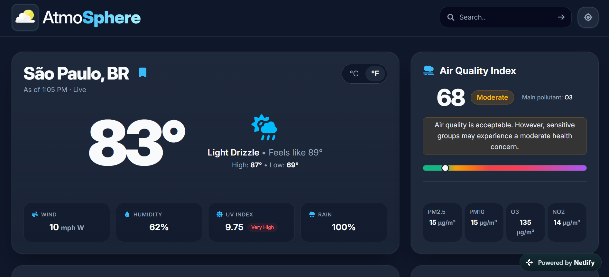
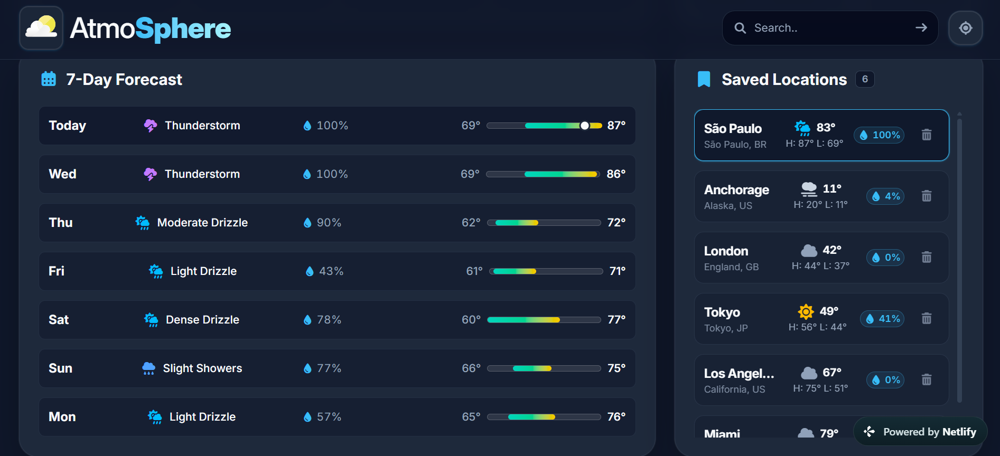
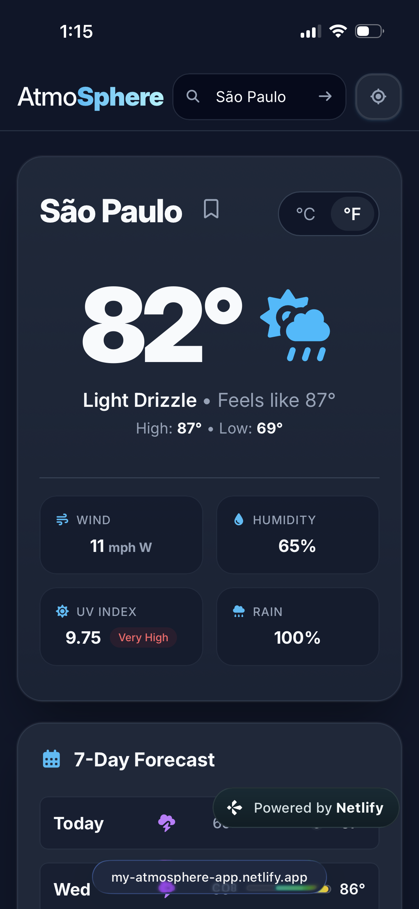
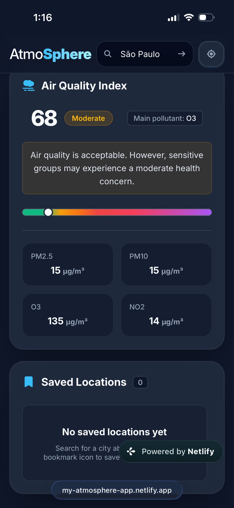

# AtmoSphere

AtmoSphere is an international weather application that allows users to search for cities around the world, explore current weather conditions, view a 7-day forecast, and monitor air quality.

Built with HTML5, vanilla JavaScript, Tailwind CSS, and Vite, the application provides a responsive interface with location-based weather data and persistent saved locations.

## Live Demo

[View AtmoSphere](https://my-atmosphere-app.netlify.app/)

## Screenshots

### Desktop

<p align="center">
  
  &nbsp;&nbsp;&nbsp;
  
</p>

### Mobile

<p align="center">
  
  &nbsp;&nbsp;&nbsp;
  
</p>

## Features

- Search for cities around the world.
- View current weather conditions and temperature.
- Explore a 7-day weather forecast.
- Monitor air quality and pollutant levels.
- Switch between Fahrenheit and Celsius.
- Use your current location to retrieve local weather.
- Save and manage favorite locations.
- Responsive interface across desktop and mobile devices.

## Technologies Used

- **HTML5** – Application structure.
- **JavaScript (ES6+)** – Application logic and interactivity.
- **Tailwind CSS v4** – Styling and layout.
- **Vite** – Development server and production build tool.
- **Open-Meteo API** – Weather forecasts and geocoding data.
- **BigDataCloud API** – Reverse geocoding for location information.

## Installation & Setup

1. Clone the repository:

   ```bash
   git clone https://github.com/eceron1999/atmosphere-app.git
   ```

2. Navigate to the project directory:

   ```bash
   cd atmosphere-app
   ```

3. Install dependencies:

   ```bash
   npm install
   ```

4. Start the development server:

   ```bash
   npm run dev
   ```

## Data Sources

- [Open-Meteo](https://open-meteo.com/) – Weather forecasts, current weather, air quality, and geocoding data.
- [BigDataCloud](https://www.bigdatacloud.com/) – Reverse geocoding for location information.
